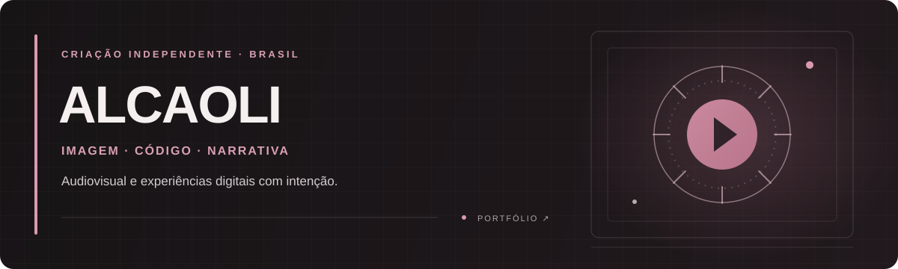

  
  
  

 

## ✧ Sobre

Sou Alcaoli, criador independente no Brasil. Transito entre audiovisual e desenvolvimento para criar projetos com personalidade — cada ideia pede sua própria linguagem.

> *Criar coisas que possam ser vistas, experimentadas e lembradas.*

## ◌ Dois caminhos. Um olhar.

<table>
  <tr>
    <td width="50%" valign="top">
      <h3>🎬 Audiovisual</h3>
      
Filmes, vídeos e narrativas visuais que carregam uma sensação — e ficam com você.

    </td>
    <td width="50%" valign="top">
      <h3>⌘ Desenvolvimento</h3>
      
Sites e experiências digitais onde o design encontra tecnologia e cada detalhe tem propósito.

    </td>
  </tr>
</table>

## ⟡ Linguagens & ferramentas

  
  
  
  

TypeScript e CSS nos projetos web · Next.js e Godot nos projetos digitais e interativos

## ✦ Projetos em destaque

<table>
  <tr>
    <td width="50%" valign="top">
      <h3>01 / Flomar Propiedades</h3>
      
Uma experiência digital para apresentar imóveis e a identidade de uma imobiliária na Argentina.

      <a href="https://github.com/alcaoli/flomar.propiedades">REPOSITÓRIO ↗</a>
    </td>
    <td width="50%" valign="top">
      <h3>02 / Projeto Billie</h3>
      
Narrativa interativa autoral em desenvolvimento, combinando direção visual, criação de mundos e jogos.

      <a href="https://portfolio-alca.vercel.app/desenvolvimento.html#portfolio">VER PROJETO ↗</a>
    </td>
  </tr>
</table>

---

  <h3>Tem uma ideia? Vamos dar forma a ela.</h3>
  <a href="https://portfolio-alca.vercel.app">✧ Conheça meu trabalho</a> &nbsp;·&nbsp;
  <a href="https://instagram.com/alcaolii">✉ Fale comigo</a>
    
  IMAGEM · CÓDIGO · NARRATIVA

